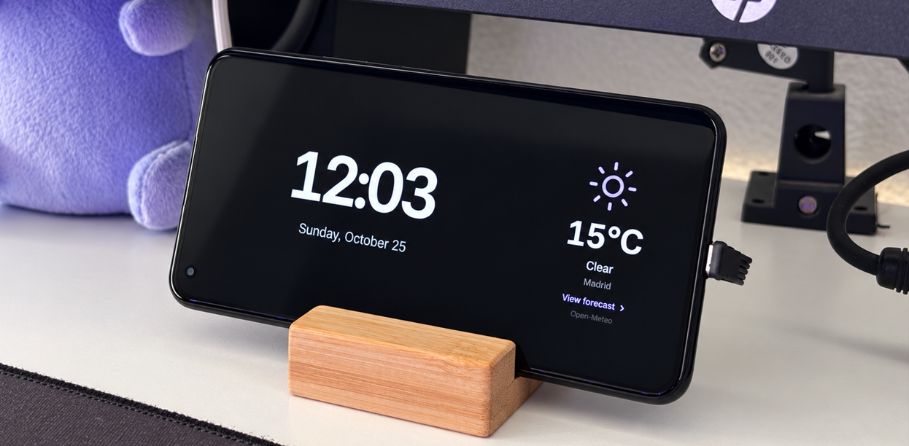
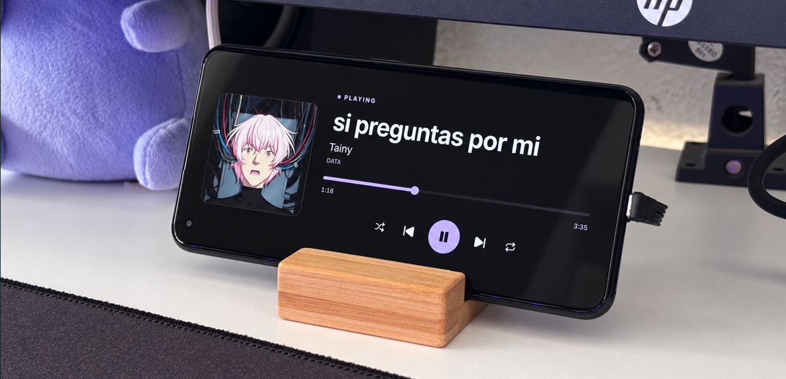

# SpotDock

Turn an old Android phone into a smart clock companion and connect it to your Windows PC. SpotDock shows a clock and weather forecast, follows your music, runs custom PC actions, forwards selected Windows notifications, and rings alarms on the phones you choose. A phone can also run as a standalone clock, weather display, and alarm clock without a PC.

<div align="center" style="display: flex; flex-direction: column; align-items: center; gap: 1em;">
<div>
  
  <i align="center">SpotDock running on a phone beside my computer, showing the clock and weather for my city</i>
</div>
<div>
  
  <i align="center">The Spotify player displaying the song im currently playing on my computer, with full controls and track data</i>
</div>
</div>
<br/>

SpotDock consists of a Windows desktop app and an Android app. They pair with a QR code and communicate on your local network. You can connect multiple phones to one PC and place them around a room or home.

The project is open source under the [MIT license](LICENSE). Contributions are welcome; see the [contributor guide](CONTRIBUTING.md) and [security policy](SECURITY.md).

## What it can do

| Feature | How it works |
| --- | --- |
| Clock and weather | Digital or analog clock, current conditions, hourly forecast, and seven-day forecast. Each phone fetches weather directly from [Open-Meteo](https://open-meteo.com/); its city and display preferences can be set locally. |
| Music controls | The PC reads Windows media sessions, including Spotify, and sends playback information to the dock. An optional Spotify Web API connection can provide a fallback. |
| Custom control deck | Up to 24 buttons can open a URL, launch a Windows app or shortcut, send a keyboard shortcut, control playback, or change the phone's view. |
| Windows notifications | Opt-in forwarding of Discord and WhatsApp notifications, including WhatsApp Web notifications delivered through Windows, to every connected phone. Each phone shows a temporary banner. |
| Multiple phones | Name, disconnect, and test each paired phone from the desktop app. Choose which phones ring for each alarm. |
| Alarms | Weekly alarms with a label, optional reminder, tone, vibration, configurable snooze, and tap or swipe dismissal. Android schedules each phone's alarms locally, so they can ring without a PC connection. |
| Screen schedule | Set visible hours for each day. Outside those hours the app displays black while the phone remains on and able to ring alarms. Each phone can override the shared schedule. |
| Dedicated dock mode | The **release** Android app can be configured as a launcher and, on a properly provisioned device, use Android lock task mode. The debug app remains a normal app for testing. |
| Background desktop service | Closing the Windows window leaves SpotDock in the system tray with its server running. Optional start with Windows launches it hidden. |
| Languages | English (US) and Spanish (Spain). The desktop app detects the Windows language and shares it with connected phones; each app also has its own language selector. Unsupported languages fall back to English. |

## Hardware and network

These are practical recommendations, not benchmarked minimums.

| Device | Requirement and recommendation |
| --- | --- |
| Windows PC | Windows 10 or 11, WebView2, and a local network connection. Spotify Desktop is useful for Windows media-session integration. |
| Android phone | Android 7.0+ is the app's declared minimum (`minSdk 24`). For a permanent dock, we recommend a reasonably recent ARM64 phone with Android 10+, at least 3 GB RAM, a landscape display of roughly 720p or better, and reliable power. OLED/AMOLED works especially well with the black screen schedule. A camera makes QR pairing convenient; manual pairing is also available. |
| Network | Put the PC and phones on the same trusted LAN. The network must allow device-to-device traffic; guest Wi-Fi and client isolation often prevent pairing. Allow TCP **47917** for the connection and UDP **47918** for discovery when the PC's IP changes. |

SpotDock is designed for a phone that stays powered on. Its scheduled black view is **not** a hardware power-off or a way to reboot the phone automatically. On Android 17 or later, grant the local network permission when prompted.

## Install and pair

For a source installation, follow the [build guide](docs/building.md). It covers prerequisites, signed Android release builds, Windows installers, and the optional notification-capable MSIX package.

1. Build and install SpotDock Desktop on the Windows PC and the signed Android APK on each production phone, following the [build guide](docs/building.md). Use a debug APK for a separate test phone.
2. Start the desktop app. Allow access on **private networks** if Windows Firewall asks. If it selects a VPN or other incorrect address, set the PC's Wi-Fi/LAN address in desktop **Settings** so the QR code uses the right IP.
3. Open SpotDock on the phone and scan the desktop QR code. The phone saves the address and pairing token and reconnects automatically. You can also enter the connection address manually in mobile **Settings**.
4. Repeat for additional phones. Use desktop **Devices** to give them meaningful names and to test or disconnect each one.

If the PC's IP changes, a paired phone can discover its new address on the LAN. Discovery does not replace an old pairing token: after regenerating the desktop token, scan the new QR code on every phone. Disconnecting a phone removes its saved pairing, while its local settings and alarms remain on that phone.

### Use a phone without a PC

Open mobile **Settings**, choose a weather location, and configure the clock, weather units, accent color, and weekly screen schedule. These settings live on the phone. If you later pair it with a PC, each locally edited group can remain local or be switched back to the shared desktop settings. Alarms also run locally. Music controls, PC actions, and forwarded Windows notifications require the desktop app.

### Optional dedicated mode

For a production dock that starts after reboot and cannot be exited with Home/Recents, follow the [dedicated Android device guide](docs/android-dedicated-mode.md). This requires device-owner provisioning; selecting SpotDock as the launcher alone does not lock the phone. The guide includes Wi-Fi maintenance and recovery steps. Keep a normal debug installation on a test phone.

## Everyday use

Tap the clock to open music controls. Tap the weather area to see hourly and weekly forecasts; tap an hour or day for more detail. The control deck runs actions configured on the PC. Tap near the top edge to reveal mobile navigation. After a period without interaction, secondary views return to the clock or, while music is playing, the player. The desktop tray menu lets you reopen the window or fully quit the app; **Settings** can enable hidden startup with Windows.

See [Alarms](docs/alarms.md) for scheduling and Android permissions, and [Notifications](docs/notifications.md) for Windows permission, supported sources, and the limits of notification content.

## Build and develop

The apps use [Tauri 2](https://v2.tauri.app/), React, TypeScript, Rust, and a Bun workspace. On Windows, after installing the [Tauri prerequisites](https://v2.tauri.app/start/prerequisites/) and Bun:

```powershell
git clone https://github.com/holasoyender/spotdock.git
cd spotdock
bun install --frozen-lockfile
bun run dev:desktop
```

For Android development, install the Android SDK/NDK and JDK as described in the [build guide](docs/building.md), connect a test phone with USB debugging, then run `bun run dev:mobile` in another terminal. The debug variant has a separate package ID and does not enable dedicated mode.

The main commands are:

```powershell
bun run build:desktop    # Windows Tauri bundles
bun run build:android    # signed Android release APK; needs your private keystore
bun run check            # TypeScript
bun run test             # Bun tests
bun run build:frontends  # production web assets for both apps
```

For the source layout, protocol and compatibility rules, translation workflow, full checks, and pull-request guidance, read [CONTRIBUTING.md](CONTRIBUTING.md) and the [architecture guide](docs/architecture.md).

## Privacy, external services, and limitations

- The PC/phone connection uses an authenticated WebSocket on the local network. It uses `ws://`, so the traffic is **not encrypted**; use a trusted LAN. The QR code contains a secret pairing token. Regenerate it in desktop Settings if it has been exposed, then pair phones again.
- Phones request weather from Open-Meteo over HTTPS. Check the [Open-Meteo terms](https://open-meteo.com/en/terms) for your intended use, especially commercial use and attribution. The PC contacts Spotify over HTTPS only if you configure the optional Web API fallback.
- The desktop app can read only notifications actually delivered to Windows. It can show the application icon when available, but Windows' notification listener does not provide other apps' sender profile photos. Notification forwarding is off by default and does not store or replay messages.
- The Spotify Web API fallback requires your own Spotify developer app and authorization. Spotify's [development-mode limits](https://developer.spotify.com/documentation/web-api/concepts/quota-modes) apply; the app owner needs Premium under the current development-mode rules.
- Dedicated mode and exact alarm behavior depend on Android provisioning, permissions, and device firmware. Test them on the actual phones before relying on them. See the [dedicated-device](docs/android-dedicated-mode.md) and [alarm](docs/alarms.md) guides.

## License and support

SpotDock is licensed under [MIT](LICENSE). For bugs and feature requests, open a GitHub issue with the app versions, Windows/Android versions, reproduction steps, and relevant logs with secrets removed. For vulnerabilities, follow [SECURITY.md](SECURITY.md) instead of filing a public issue.
